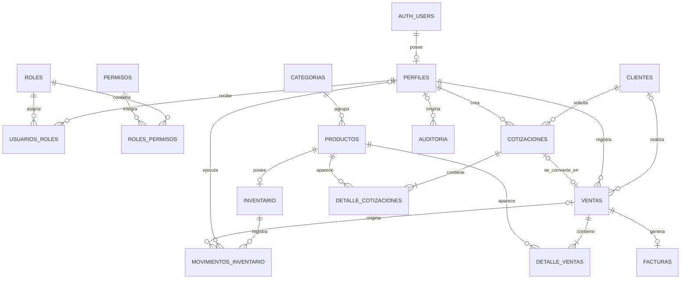

# Modelo de datos inicial de ECOFARM S.A.

Este documento presenta un diseño lógico preliminar para la futura base de datos de ECOFARM S.A. No contiene sentencias SQL ni representa una migración lista para ejecutarse. Los campos, restricciones y relaciones deberán revisarse antes de implementar cada módulo.

## 1. Objetivo del modelo de datos

Definir una base coherente para almacenar la información de seguridad, operación y trazabilidad del sistema web de gestión/POS. El modelo busca:

- mantener separadas la autenticación, la autorización y la información del perfil;
- conservar el historial de ventas, cotizaciones y movimientos de inventario;
- evitar duplicidad innecesaria y dependencias ambiguas;
- facilitar validaciones, permisos, auditoría y transacciones futuras;
- permitir que el sistema evolucione sin asumir requisitos empresariales todavía desconocidos.

## 2. Convenciones de nombres

- Los objetos propios de ECOFARM utilizarán nombres en español.
- Los nombres estarán en minúsculas, en `snake_case`, sin tildes y sin la letra `ñ`.
- `auth.users` es la única excepción porque pertenece internamente a Supabase Auth.
- Las claves primarias se llamarán normalmente `id`.
- Las claves foráneas utilizarán el formato `entidad_id`.
- Los identificadores internos se recomiendan inicialmente como `uuid`.
- Los números visibles para usuarios, como `numero_venta`, serán independientes del `uuid` interno.
- Las tablas puente `usuarios_roles` y `roles_permisos` podrán usar claves primarias compuestas porque su identidad está formada naturalmente por sus dos relaciones.
- Los campos `fecha_creacion` y `fecha_actualizacion` utilizarán fecha y hora con zona horaria.
- Los estados se escribirán en minúsculas y sin tildes.

## 3. Evaluación general de las entidades

Las entidades propuestas tienen una responsabilidad diferenciada y son adecuadas para el alcance inicial.

### Entidades de seguridad y acceso

- `auth.users` administra la identidad y las credenciales mediante Supabase Auth.
- `perfiles` contiene información propia de ECOFARM sobre cada usuario autenticado.
- `roles` agrupa responsabilidades generales.
- `permisos` representa acciones específicas autorizables.
- `usuarios_roles` resuelve la relación de muchos a muchos entre usuarios y roles.
- `roles_permisos` resuelve la relación de muchos a muchos entre roles y permisos.

### Entidades de negocio

- `clientes`, `categorias` y `productos` mantienen los catálogos principales.
- `inventario` conserva la existencia actual de cada producto.
- `movimientos_inventario` conserva el historial que explica cada cambio de existencia.
- `ventas` y `detalle_ventas` representan el encabezado y las líneas de una operación de venta.
- `cotizaciones` y `detalle_cotizaciones` representan propuestas que todavía no afectan inventario.
- `facturas` representa provisionalmente el documento generado a partir de una venta.

### Entidad de trazabilidad

- `auditoria` registra acciones sensibles realizadas en el sistema.

`movimientos_inventario` y `auditoria` no son redundantes. El movimiento es un registro funcional que explica el saldo de stock; la auditoría documenta quién ejecutó una acción sensible y qué información cambió.

`inventario` se mantiene separado de `productos` con una relación inicial uno a uno. Esto separa el catálogo comercial del saldo operativo. Si ECOFARM maneja varias bodegas o ubicaciones, esta relación deberá rediseñarse antes de implementar inventario.

El alcance de `facturas` es provisional. No se diseñará una integración FEL ni una estructura fiscal definitiva hasta conocer el proceso real de ECOFARM.

## 4. Entidades de seguridad y acceso

### 4.1 `auth.users`

Tabla administrada por Supabase Auth. Almacena la identidad autenticable y las credenciales de forma segura. No debe renombrarse, recrearse ni utilizarse como una tabla de negocio.

Los siguientes campos son únicamente referencias relevantes para relacionar el modelo; Supabase mantiene otros campos internos que no se diseñan aquí.

| Campo relevante | Propósito | Tipo PostgreSQL | Permite NULL | Clave o restricción conceptual |
| --- | --- | --- | --- | --- |
| `id` | Identificador del usuario autenticado | `uuid` | No | PK administrada por Supabase |
| `email` | Correo utilizado por el mecanismo de autenticación, cuando aplique | `text` | Depende del proveedor | Administración y reglas de Supabase Auth |
| `created_at` | Fecha de creación de la identidad | `timestamptz` | No | Administrado por Supabase |

Las contraseñas, tokens y datos internos de autenticación no se duplicarán en tablas propias.

### 4.2 `perfiles`

Amplía la identidad de `auth.users` con datos que necesita ECOFARM. Su `id` será al mismo tiempo PK y FK hacia `auth.users.id`, formando una relación uno a uno.

| Campo | Propósito | Tipo PostgreSQL recomendado | Permite NULL | Clave o restricción conceptual |
| --- | --- | --- | --- | --- |
| `id` | Identificador compartido con Supabase Auth | `uuid` | No | PK y FK a `auth.users.id` |
| `nombre_completo` | Nombre visible del usuario dentro del sistema | `varchar(150)` | No | — |
| `telefono` | Medio de contacto interno | `varchar(30)` | Sí | — |
| `activo` | Permite desactivar el acceso operativo sin borrar historial | `boolean` | No | Valor inicial conceptual `true` |
| `fecha_creacion` | Momento de creación del perfil | `timestamptz` | No | — |
| `fecha_actualizacion` | Última actualización del perfil | `timestamptz` | No | — |

No se propone almacenar una contraseña ni duplicar automáticamente el correo. Si el negocio necesita mostrar o buscar el correo fuera de Supabase Auth, deberá decidirse si se consulta desde Auth o se mantiene una copia sincronizada.

### 4.3 `roles`

Define agrupaciones de permisos, como administrador o encargado de inventario. La autorización final no dependerá únicamente del nombre del rol.

| Campo | Propósito | Tipo PostgreSQL recomendado | Permite NULL | Clave o restricción conceptual |
| --- | --- | --- | --- | --- |
| `id` | Identificador interno | `uuid` | No | PK |
| `nombre` | Nombre legible del rol | `varchar(80)` | No | UNIQUE |
| `descripcion` | Explicación de sus responsabilidades | `text` | Sí | — |
| `activo` | Indica si puede seguir asignándose | `boolean` | No | Valor inicial conceptual `true` |
| `fecha_creacion` | Momento de creación | `timestamptz` | No | — |
| `fecha_actualizacion` | Momento de última modificación | `timestamptz` | No | — |

### 4.4 `permisos`

Representa una acción específica que posteriormente podrá comprobar el backend, por ejemplo `producto.ver` o `venta.anular`.

| Campo | Propósito | Tipo PostgreSQL recomendado | Permite NULL | Clave o restricción conceptual |
| --- | --- | --- | --- | --- |
| `id` | Identificador interno | `uuid` | No | PK |
| `codigo` | Código estable utilizado por la autorización | `varchar(100)` | No | UNIQUE |
| `nombre` | Nombre legible | `varchar(120)` | No | — |
| `descripcion` | Explicación funcional | `text` | Sí | — |
| `activo` | Indica si el permiso continúa disponible | `boolean` | No | Valor inicial conceptual `true` |
| `fecha_creacion` | Momento de creación | `timestamptz` | No | — |
| `fecha_actualizacion` | Momento de última modificación | `timestamptz` | No | — |

### 4.5 `usuarios_roles`

Asigna uno o varios roles a un perfil. No necesita un `id` artificial si se utiliza la combinación de usuario y rol como identidad.

| Campo | Propósito | Tipo PostgreSQL recomendado | Permite NULL | Clave o restricción conceptual |
| --- | --- | --- | --- | --- |
| `usuario_id` | Usuario que recibe el rol | `uuid` | No | PK compuesta y FK a `perfiles.id` |
| `rol_id` | Rol asignado | `uuid` | No | PK compuesta y FK a `roles.id` |
| `fecha_asignacion` | Momento en que se realizó la asignación | `timestamptz` | No | — |

La combinación `usuario_id` y `rol_id` debe ser única para impedir asignaciones duplicadas.

### 4.6 `roles_permisos`

Asigna permisos específicos a cada rol.

| Campo | Propósito | Tipo PostgreSQL recomendado | Permite NULL | Clave o restricción conceptual |
| --- | --- | --- | --- | --- |
| `rol_id` | Rol que obtiene el permiso | `uuid` | No | PK compuesta y FK a `roles.id` |
| `permiso_id` | Permiso asignado | `uuid` | No | PK compuesta y FK a `permisos.id` |
| `fecha_asignacion` | Momento de la asignación | `timestamptz` | No | — |

La combinación `rol_id` y `permiso_id` debe ser única.

## 5. Entidades de negocio

### 5.1 `clientes`

Conserva la información básica de las personas o entidades que realizan compras o solicitan cotizaciones. Los campos fiscales definitivos siguen pendientes.

| Campo | Propósito | Tipo PostgreSQL recomendado | Permite NULL | Clave o restricción conceptual |
| --- | --- | --- | --- | --- |
| `id` | Identificador interno | `uuid` | No | PK |
| `nit` | Identificador tributario conservado como texto | `varchar(20)` | Sí | UNIQUE cuando exista; normalización pendiente |
| `nombre` | Nombre o razón utilizada por ECOFARM | `varchar(200)` | No | — |
| `direccion` | Dirección del cliente | `text` | Sí | — |
| `telefono` | Teléfono de contacto | `varchar(30)` | Sí | — |
| `correo` | Correo de contacto | `varchar(254)` | Sí | — |
| `activo` | Permite inactivar sin eliminar operaciones históricas | `boolean` | No | Valor inicial conceptual `true` |
| `fecha_creacion` | Momento de registro | `timestamptz` | No | — |
| `fecha_actualizacion` | Última modificación | `timestamptz` | No | — |

El NIT no debe almacenarse como número porque puede contener guiones, caracteres especiales o valores convencionales. Debe definirse posteriormente cómo representar consumidor final.

### 5.2 `categorias`

Agrupa productos para facilitar organización, búsqueda y reportes.

| Campo | Propósito | Tipo PostgreSQL recomendado | Permite NULL | Clave o restricción conceptual |
| --- | --- | --- | --- | --- |
| `id` | Identificador interno | `uuid` | No | PK |
| `nombre` | Nombre de la categoría | `varchar(120)` | No | UNIQUE |
| `descripcion` | Información adicional | `text` | Sí | — |
| `activo` | Indica si puede utilizarse en nuevos productos | `boolean` | No | Valor inicial conceptual `true` |
| `fecha_creacion` | Momento de creación | `timestamptz` | No | — |
| `fecha_actualizacion` | Última modificación | `timestamptz` | No | — |

### 5.3 `productos`

Representa el catálogo comercial. No almacena directamente la existencia actual.

| Campo | Propósito | Tipo PostgreSQL recomendado | Permite NULL | Clave o restricción conceptual |
| --- | --- | --- | --- | --- |
| `id` | Identificador interno | `uuid` | No | PK |
| `categoria_id` | Categoría a la que pertenece | `uuid` | No, inicialmente | FK a `categorias.id` |
| `codigo` | Código interno de búsqueda | `varchar(60)` | No | UNIQUE |
| `nombre` | Nombre comercial | `varchar(200)` | No | — |
| `descripcion` | Descripción ampliada | `text` | Sí | — |
| `unidad_medida` | Unidad usada para expresar cantidades | `varchar(30)` | No | Valores definitivos pendientes |
| `precio_venta` | Precio de venta vigente | `numeric(14,2)` | No | CHECK conceptual mayor o igual a cero |
| `stock_minimo` | Umbral para alertas de existencia | `numeric(14,3)` | No | CHECK conceptual mayor o igual a cero |
| `activo` | Permite retirar un producto sin perder historial | `boolean` | No | Valor inicial conceptual `true` |
| `fecha_creacion` | Momento de creación | `timestamptz` | No | — |
| `fecha_actualizacion` | Última modificación | `timestamptz` | No | — |

`unidad_medida` se mantiene como campo preliminar. Solo se justificará una entidad adicional si ECOFARM necesita un catálogo controlado, conversiones o diferentes presentaciones.

### 5.4 `inventario`

Mantiene el saldo actual de un producto. Inicialmente existirá como máximo un registro de inventario por producto.

| Campo | Propósito | Tipo PostgreSQL recomendado | Permite NULL | Clave o restricción conceptual |
| --- | --- | --- | --- | --- |
| `id` | Identificador interno | `uuid` | No | PK |
| `producto_id` | Producto cuyo saldo se almacena | `uuid` | No | FK a `productos.id` y UNIQUE |
| `cantidad` | Existencia actual | `numeric(14,3)` | No | CHECK según política de stock negativo |
| `fecha_actualizacion` | Momento del último cambio de saldo | `timestamptz` | No | — |

La restricción UNIQUE sobre `producto_id` expresa la relación uno a uno. Si existen varias bodegas, será necesario incorporar la ubicación al saldo y cambiar esta restricción antes de implementar el módulo.

### 5.5 `movimientos_inventario`

Registra cada cambio que explica el saldo de inventario. No debe alterarse el saldo sin crear el movimiento correspondiente dentro de la misma transacción futura.

| Campo | Propósito | Tipo PostgreSQL recomendado | Permite NULL | Clave o restricción conceptual |
| --- | --- | --- | --- | --- |
| `id` | Identificador del movimiento | `uuid` | No | PK |
| `inventario_id` | Saldo afectado | `uuid` | No | FK a `inventario.id` |
| `usuario_id` | Usuario responsable | `uuid` | Sí solo para procesos automáticos o migraciones | FK a `perfiles.id` |
| `venta_id` | Venta que originó el movimiento, cuando aplique | `uuid` | Sí | FK a `ventas.id` |
| `tipo_movimiento` | Clasificación: entrada, salida o ajuste | `varchar(30)` | No | CHECK con valores permitidos |
| `origen` | Contexto: venta, manual, corrección u otro autorizado | `varchar(30)` | No | CHECK futuro |
| `cantidad` | Variación firmada; positiva o negativa | `numeric(14,3)` | No | CHECK conceptual diferente de cero |
| `existencia_anterior` | Saldo antes del cambio | `numeric(14,3)` | No | — |
| `existencia_resultante` | Saldo después del cambio | `numeric(14,3)` | No | CHECK según política de stock negativo |
| `motivo` | Explicación de la operación | `text` | Sí; obligatoria en ajustes o correcciones | Regla condicional futura |
| `fecha_movimiento` | Momento efectivo del movimiento | `timestamptz` | No | — |

La cantidad firmada y los saldos anterior/resultante facilitan reconstruir y verificar el historial. Sus reglas exactas deberán impedir contradicciones entre tipo, signo y saldo.

### 5.6 `ventas`

Representa el encabezado de una venta. Los totales deben corresponder a sus detalles y una venta confirmada debe coordinarse con inventario mediante una transacción.

| Campo | Propósito | Tipo PostgreSQL recomendado | Permite NULL | Clave o restricción conceptual |
| --- | --- | --- | --- | --- |
| `id` | Identificador interno | `uuid` | No | PK |
| `cliente_id` | Cliente asociado | `uuid` | Sí, sujeto a política de consumidor final | FK a `clientes.id` |
| `usuario_id` | Usuario responsable de la venta | `uuid` | No | FK a `perfiles.id` |
| `cotizacion_id` | Cotización que originó la venta | `uuid` | Sí | FK a `cotizaciones.id` y UNIQUE |
| `numero_venta` | Número visible de la operación | `varchar(40)` | No | UNIQUE |
| `subtotal` | Suma antes de descuentos | `numeric(14,2)` | No | CHECK conceptual mayor o igual a cero |
| `descuento` | Descuento total aplicado | `numeric(14,2)` | No | CHECK conceptual mayor o igual a cero |
| `total` | Importe final | `numeric(14,2)` | No | CHECK conceptual mayor o igual a cero |
| `estado` | Estado del flujo de venta | `varchar(30)` | No | CHECK futuro; valores preliminares |
| `fecha_venta` | Momento de confirmación o registro de la venta | `timestamptz` | No | — |
| `motivo_anulacion` | Razón de anulación, si ocurre | `text` | Sí | Requerido condicionalmente |
| `fecha_anulacion` | Momento de anulación | `timestamptz` | Sí | Requerido condicionalmente |
| `fecha_creacion` | Momento de creación del registro | `timestamptz` | No | — |
| `fecha_actualizacion` | Última modificación permitida | `timestamptz` | No | — |

Estados preliminares posibles: `borrador`, `confirmada` y `anulada`. Deben definirse antes de implementar y controlar qué cambios son posibles después de confirmar.

### 5.7 `detalle_ventas`

Conserva los productos, cantidades y precios utilizados en una venta. El precio histórico no debe depender del precio vigente del producto.

| Campo | Propósito | Tipo PostgreSQL recomendado | Permite NULL | Clave o restricción conceptual |
| --- | --- | --- | --- | --- |
| `id` | Identificador de la línea | `uuid` | No | PK |
| `venta_id` | Venta a la que pertenece | `uuid` | No | FK a `ventas.id` |
| `producto_id` | Producto vendido | `uuid` | No | FK a `productos.id` |
| `cantidad` | Cantidad vendida | `numeric(14,3)` | No | CHECK conceptual mayor que cero |
| `precio_unitario` | Precio aplicado al confirmar la venta | `numeric(14,2)` | No | CHECK conceptual mayor o igual a cero |
| `descuento` | Descuento aplicado a la línea, si se permite | `numeric(14,2)` | No | CHECK conceptual mayor o igual a cero |
| `subtotal` | Resultado monetario de la línea | `numeric(14,2)` | No | CHECK y coherencia calculada futura |

Debe decidirse si también se conservará una copia del nombre, código o información fiscal del producto para documentos históricos.

### 5.8 `cotizaciones`

Representa una propuesta comercial. No confirma una venta ni modifica inventario.

| Campo | Propósito | Tipo PostgreSQL recomendado | Permite NULL | Clave o restricción conceptual |
| --- | --- | --- | --- | --- |
| `id` | Identificador interno | `uuid` | No | PK |
| `cliente_id` | Cliente destinatario | `uuid` | No, inicialmente | FK a `clientes.id` |
| `usuario_id` | Usuario que crea o gestiona la cotización | `uuid` | No | FK a `perfiles.id` |
| `numero_cotizacion` | Número visible | `varchar(40)` | No | UNIQUE |
| `subtotal` | Suma antes de descuentos | `numeric(14,2)` | No | CHECK conceptual mayor o igual a cero |
| `descuento` | Descuento total | `numeric(14,2)` | No | CHECK conceptual mayor o igual a cero |
| `total` | Importe propuesto | `numeric(14,2)` | No | CHECK conceptual mayor o igual a cero |
| `fecha` | Fecha comercial de la cotización | `date` | No | — |
| `fecha_vencimiento` | Fecha límite de validez | `date` | No | CHECK posterior o igual a `fecha` |
| `observaciones` | Condiciones o notas | `text` | Sí | — |
| `estado` | Estado del flujo | `varchar(30)` | No | CHECK con estados permitidos |
| `fecha_creacion` | Momento de creación | `timestamptz` | No | — |
| `fecha_actualizacion` | Última modificación | `timestamptz` | No | — |

Estados preliminares: `borrador`, `enviada`, `aceptada`, `rechazada`, `vencida` y `convertida`. La transición a `convertida` deberá ocurrir junto con la creación válida de la venta.

### 5.9 `detalle_cotizaciones`

Conserva productos, cantidades y precios propuestos. Su precio histórico no debe cambiar cuando se actualice `productos.precio_venta`.

| Campo | Propósito | Tipo PostgreSQL recomendado | Permite NULL | Clave o restricción conceptual |
| --- | --- | --- | --- | --- |
| `id` | Identificador de la línea | `uuid` | No | PK |
| `cotizacion_id` | Cotización a la que pertenece | `uuid` | No | FK a `cotizaciones.id` |
| `producto_id` | Producto cotizado | `uuid` | No | FK a `productos.id` |
| `cantidad` | Cantidad propuesta | `numeric(14,3)` | No | CHECK conceptual mayor que cero |
| `precio_unitario` | Precio ofrecido en ese momento | `numeric(14,2)` | No | CHECK conceptual mayor o igual a cero |
| `descuento` | Descuento de la línea, si se permite | `numeric(14,2)` | No | CHECK conceptual mayor o igual a cero |
| `subtotal` | Importe de la línea | `numeric(14,2)` | No | CHECK y coherencia calculada futura |

### 5.10 `facturas`

Representa provisionalmente un documento emitido a partir de una venta válida. No describe todavía una factura FEL ni sustituye los requisitos de SAT.

| Campo | Propósito | Tipo PostgreSQL recomendado | Permite NULL | Clave o restricción conceptual |
| --- | --- | --- | --- | --- |
| `id` | Identificador interno | `uuid` | No | PK |
| `venta_id` | Venta que respalda el documento | `uuid` | No | FK a `ventas.id` y UNIQUE inicialmente |
| `numero_factura` | Número visible del documento | `varchar(60)` | No | UNIQUE; formato pendiente |
| `estado` | Estado del documento | `varchar(30)` | No | CHECK futuro |
| `fecha_emision` | Momento de emisión | `timestamptz` | No | — |
| `fecha_creacion` | Momento de creación del registro | `timestamptz` | No | — |

La relación UNIQUE inicial establece como máximo una factura por venta. Esta decisión, la numeración, los datos fiscales, anulaciones y posibles documentos rectificativos deberán replantearse con el proceso real de facturación.

## 6. Entidad de trazabilidad y auditoría

### 6.1 `auditoria`

Registra acciones sensibles sin sustituir los historiales propios de cada módulo. Debe evitar almacenar contraseñas, tokens, secretos o datos personales innecesarios.

| Campo | Propósito | Tipo PostgreSQL recomendado | Permite NULL | Clave o restricción conceptual |
| --- | --- | --- | --- | --- |
| `id` | Identificador del evento | `uuid` | No | PK |
| `usuario_id` | Usuario que ejecutó la acción | `uuid` | Sí para procesos internos justificados | FK a `perfiles.id` |
| `accion` | Acción realizada, por ejemplo crear o anular | `varchar(100)` | No | — |
| `entidad` | Tipo de recurso afectado | `varchar(100)` | No | Índice conceptual junto con `entidad_id` |
| `entidad_id` | Identificador del registro afectado | `uuid` | Sí | Referencia lógica, no FK genérica |
| `datos_anteriores` | Valores relevantes previos al cambio | `jsonb` | Sí | Excluir información sensible |
| `datos_nuevos` | Valores relevantes posteriores al cambio | `jsonb` | Sí | Excluir información sensible |
| `ip` | Dirección IP relacionada con la solicitud | `inet` | Sí | — |
| `fecha_creacion` | Momento del evento | `timestamptz` | No | Índice recomendado |

`entidad_id` no puede tener una FK tradicional porque puede apuntar conceptualmente a diferentes tablas. La aplicación deberá validar su coherencia y la auditoría debe considerarse principalmente de solo inserción.

## 7. Relaciones y cardinalidades

### Seguridad y acceso

- Un registro de `auth.users` puede tener un perfil de ECOFARM; cada `perfiles` pertenece a exactamente un usuario autenticado.
- Un perfil puede tener cero o muchos roles y un rol puede pertenecer a muchos perfiles mediante `usuarios_roles`.
- Un rol puede contener muchos permisos y un permiso puede pertenecer a muchos roles mediante `roles_permisos`.

### Catálogos, ventas y cotizaciones

- Una categoría puede contener muchos productos; inicialmente cada producto pertenece a una categoría.
- Un cliente puede tener muchas ventas; una venta puede asociarse con cero o un cliente mientras se define consumidor final.
- Una venta contiene uno o muchos detalles y cada detalle pertenece a una venta.
- Un producto puede aparecer en muchos detalles de venta.
- Un cliente puede tener muchas cotizaciones y cada cotización pertenece inicialmente a un cliente.
- Una cotización contiene uno o muchos detalles y un producto puede aparecer en muchos detalles de cotización.
- Una cotización puede convertirse como máximo en una venta mediante `ventas.cotizacion_id`.
- Una venta puede generar como máximo una factura en el modelo provisional.

### Inventario

- Un producto tiene como máximo un registro de inventario en el modelo inicial.
- Un registro de inventario puede tener muchos movimientos.
- Una venta confirmada puede originar varios movimientos, normalmente uno por producto afectado.
- Un perfil puede ser responsable de muchas ventas, cotizaciones y movimientos.

### Auditoría

- Un perfil puede originar muchos eventos de auditoría.
- La entidad e identificador afectados se conservan como referencia lógica para permitir auditar diferentes módulos.

## 8. Relación entre Supabase Auth, perfiles, roles y permisos

El flujo futuro de identidad y autorización será:

1. Supabase Auth autentica al usuario mediante `auth.users` y administra sus credenciales.
2. `perfiles.id` utiliza el mismo UUID de `auth.users.id` para enlazar la identidad con la información propia de ECOFARM.
3. `usuarios_roles` determina qué roles tiene el perfil.
4. `roles_permisos` determina qué permisos contiene cada rol.
5. El backend consulta o resuelve esos permisos antes de ejecutar una acción protegida.
6. RLS podrá aplicar controles adicionales cuando corresponda, pero no sustituirá la autorización de negocio del backend.

No se creará una tabla propia de contraseñas. También debe evitarse borrar usuarios que tengan historial: el procedimiento definitivo deberá definir desactivación, conservación o anonimización sin romper ventas y auditoría. Una eliminación en cascada desde `auth.users` podría destruir trazabilidad y no debe asumirse automáticamente.

## 9. Relaciones principales de negocio

### Cliente, venta y producto

```text
clientes
   → ventas
      → detalle_ventas
         → productos
```

El encabezado identifica cliente, responsable, fecha y totales. Los detalles conservan cantidad y precio histórico.

### Categorías y productos

```text
categorias
   → productos
```

La categoría organiza el catálogo, pero no contiene existencias.

### Producto e inventario

```text
productos
   → inventario
      → movimientos_inventario
```

`inventario` conserva el saldo actual; `movimientos_inventario` explica cómo se llegó a ese saldo.

### Cliente y cotización

```text
clientes
   → cotizaciones
      → detalle_cotizaciones
         → productos
```

La cotización conserva la propuesta sin afectar stock. Si se convierte, la venta mantiene una referencia única a su cotización de origen.

### Venta y factura

```text
ventas
   → facturas
```

La factura reutiliza una venta válida. Su alcance fiscal continúa pendiente.

## 10. Reglas de negocio preliminares

1. Una cotización no disminuye ni reserva inventario en el alcance actual.
2. Solo una venta confirmada puede afectar inventario.
3. Confirmar una venta debe registrar encabezado, detalles, movimientos y saldo de inventario dentro de una transacción futura.
4. Si falla un cambio crítico de inventario, la venta no debe quedar confirmada parcialmente.
5. `detalle_ventas.precio_unitario` conserva el precio utilizado, aunque cambie `productos.precio_venta`.
6. `detalle_cotizaciones.precio_unitario` conserva el precio ofrecido históricamente.
7. Los totales del encabezado deben ser coherentes con sus detalles y descuentos.
8. El saldo de inventario no debe modificarse directamente sin un movimiento asociado.
9. Todo ajuste o corrección de inventario debe registrar motivo y usuario responsable cuando sea una acción humana.
10. Una factura debe relacionarse con una venta válida y en el estado que se defina como facturable.
11. No se simulará una integración FEL. Cualquier integración futura dependerá del certificador, SAT, requisitos legales y costos.
12. Las anulaciones no deben borrar ventas, facturas ni movimientos históricos; deben utilizar estados y operaciones compensatorias cuando corresponda.
13. Las acciones deberán autorizarse posteriormente mediante permisos específicos resueltos en el backend.
14. Los registros con historial deben inactivarse o cambiar de estado en lugar de eliminarse físicamente, salvo una regla explícita.
15. La conversión de una cotización y la creación de su venta deben impedir conversiones duplicadas.

## 11. Tipos de datos recomendados

### Dinero y precios

Se recomienda `numeric(14,2)` para precios, descuentos, subtotales y totales. `real` y `double precision` no son adecuados para dinero porque almacenan aproximaciones binarias que pueden producir errores de redondeo.

La precisión definitiva dependerá de los importes máximos y la moneda utilizada por ECOFARM.

### Cantidades de inventario

Se recomienda inicialmente `numeric(14,3)` porque algunos productos agrícolas podrían manejar fracciones. Si todos los productos se venden exclusivamente por unidades enteras, podrá restringirse la escala. Deben definirse unidades y reglas de redondeo antes de implementar.

### Fechas y horas

- `timestamptz` para eventos exactos: creación, venta, movimiento, anulación y auditoría.
- `date` para fechas comerciales sin una hora relevante, como fecha y vencimiento de una cotización.

Guardar eventos con zona horaria permite conservar un instante inequívoco y mostrarlos después en la zona de Guatemala.

### UUID

Se recomienda `uuid` para claves internas. Es obligatorio para enlazar `perfiles.id` con `auth.users.id` y mantiene consistencia en las relaciones. Los números de documentos seguirán siendo campos separados, legibles y únicos.

### Booleanos

`boolean` es apropiado para condiciones binarias como `activo`. No debe reemplazar estados con más de dos posibilidades.

### Textos

- `varchar(n)` cuando existe un límite funcional razonable, por ejemplo códigos y nombres.
- `text` para descripciones, direcciones, observaciones y motivos variables.
- NIT, teléfonos y números de documento deben tratarse como texto, no como cantidades matemáticas.

### Estados

Se recomienda inicialmente `varchar` acompañado por `CHECK`, en lugar de un tipo ENUM nativo, porque los flujos todavía pueden cambiar. La lista permitida debe definirse por módulo antes de implementar.

### Datos estructurados de auditoría

`jsonb` permite conservar cambios con estructura variable y consultarlos posteriormente. Su contenido debe limitarse a los campos necesarios y nunca incluir credenciales o secretos.

### Direcciones IP

`inet` valida y almacena direcciones IPv4 o IPv6 de forma más apropiada que un texto libre.

## 12. Restricciones e índices conceptuales

### `NOT NULL`

Debe aplicarse a identificadores, relaciones obligatorias, nombres, cantidades, importes, estados y fechas esenciales. Los campos opcionales no deben rellenarse con cadenas vacías para evitar `NULL`.

### `UNIQUE`

Se recomienda conceptualmente para:

- `roles.nombre`;
- `permisos.codigo`;
- `categorias.nombre`;
- `productos.codigo`;
- NIT normalizado cuando corresponda;
- `inventario.producto_id` en el modelo de una ubicación;
- `ventas.numero_venta`;
- `ventas.cotizacion_id` cuando no sea `NULL`;
- `cotizaciones.numero_cotizacion`;
- `facturas.numero_factura`;
- `facturas.venta_id` en el modelo provisional;
- combinaciones de las tablas puente.

### `FOREIGN KEY`

Las FK deben proteger la integridad entre encabezados, detalles, catálogos y usuarios. Las reglas de eliminación deben definirse conscientemente:

- restringir la eliminación de registros con historial;
- evitar cascadas desde usuarios hacia ventas o auditoría;
- permitir cascada desde un encabezado en borrador hacia sus detalles solo si el flujo lo justifica;
- preferir inactivación o estados para información ya confirmada.

### `CHECK`

Podrá utilizarse para:

- impedir cantidades de detalle menores o iguales a cero;
- impedir precios, descuentos y totales negativos;
- validar estados y tipos de movimiento;
- exigir que el vencimiento no sea anterior a la fecha de cotización;
- controlar la coherencia entre movimiento, signo y saldo;
- aplicar la política futura sobre stock negativo;
- exigir motivo y fecha cuando una operación esté anulada.

### Índices

Además de los índices creados por PK y UNIQUE, podrían requerirse índices para:

- claves foráneas utilizadas en consultas frecuentes;
- búsqueda por nombre o código de producto;
- búsqueda normalizada por NIT;
- fechas y estados de ventas y cotizaciones;
- `movimientos_inventario` por inventario y fecha;
- `auditoria` por usuario, entidad y fecha.

Los índices deberán responder a consultas reales. Agregarlos indiscriminadamente aumenta el costo de escritura y almacenamiento.

## 13. Diagrama lógico inicial

El nombre `AUTH_USERS` representa en el diagrama la tabla interna `auth.users`.



## 14. Decisiones pendientes antes de implementar

Las siguientes preguntas no agregan entidades al modelo inicial. Deben resolverse con ECOFARM o durante el análisis específico de cada módulo:

### Clientes y documentos

- ¿Qué campos fiscales exige realmente ECOFARM para sus clientes?
- ¿Cómo se representará consumidor final y cuándo será obligatorio un cliente registrado?
- ¿El NIT debe conservar guiones, normalizarse o validarse mediante una regla específica?
- ¿Ventas y cotizaciones deben guardar una copia histórica del nombre, NIT y dirección del cliente?
- ¿Los detalles deben guardar también una copia del nombre y código del producto?

### Productos e inventario

- ¿Qué unidades de medida utiliza ECOFARM y cuántos decimales necesita cada una?
- ¿Se permiten fracciones y cómo deben redondearse?
- ¿Se permitirá stock negativo bajo alguna condición?
- ¿Existe una sola ubicación de inventario o varias bodegas/sucursales?
- ¿Se necesita código de barras además del código interno?
- ¿Se requiere registrar costo para márgenes y valoración?
- ¿Las entradas de inventario necesitarán posteriormente proveedores y compras?

### Ventas y pagos

- ¿Cuál es el flujo exacto entre borrador, confirmación y anulación?
- ¿Cómo se numerarán las ventas y se evitarán colisiones concurrentes?
- ¿Se aceptan descuentos por línea, descuento general o ambos?
- ¿Qué moneda y reglas de redondeo se utilizarán?
- ¿Se necesita registrar pagos, métodos de pago, pagos mixtos, crédito, caja o turnos?
- ¿Cómo debe compensarse el inventario al anular una venta confirmada?

### Cotizaciones

- ¿Quién puede cambiar cada estado y cuándo se considera aceptada?
- ¿El vencimiento se marcará automáticamente o al consultarla?
- ¿Una cotización puede convertirse parcialmente o únicamente completa?
- ¿Puede modificarse después de enviada o aceptada?
- ¿Qué datos deben aparecer en el PDF futuro?

### Facturación

- ¿`facturas` representará inicialmente un comprobante interno o una factura fiscal?
- ¿ECOFARM utiliza FEL y qué certificador, API y requisitos contractuales tiene?
- ¿Una venta puede generar más de un documento o documentos rectificativos?
- ¿Cómo se manejarán serie, número, impuestos, anulaciones y datos fiscales históricos?
- ¿Qué información debe reutilizarse desde la venta y qué información debe conservarse como instantánea?

### Usuarios, seguridad y auditoría

- ¿Puede un usuario tener varios roles simultáneamente?
- ¿Qué roles y permisos iniciales serán aprobados por ECOFARM?
- ¿Cómo se creará automáticamente el perfil después de registrar un usuario en Supabase Auth?
- ¿Cuál será la política para desactivar, eliminar o anonimizar usuarios con historial?
- ¿Qué acciones exactas deben auditarse y cuánto tiempo se conservarán los registros?
- ¿Qué campos deben excluirse obligatoriamente de `datos_anteriores` y `datos_nuevos`?

### Numeración y operación empresarial

- ¿La numeración de ventas, cotizaciones y facturas es global, anual, por serie o por establecimiento?
- ¿ECOFARM opera en una sola sucursal y con una sola caja?
- ¿Existen requisitos de reportes que necesiten información adicional desde el inicio?

Estas decisiones deberán resolverse antes de convertir el diseño correspondiente en migraciones. Hasta entonces no se agregan tablas de pagos, cajas, bodegas, sucursales, unidades de medida, proveedores ni compras al modelo inicial.
